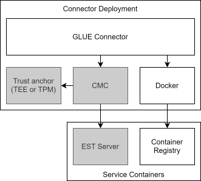
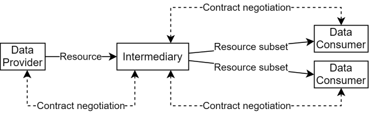
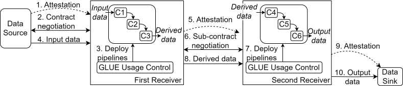
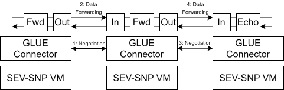
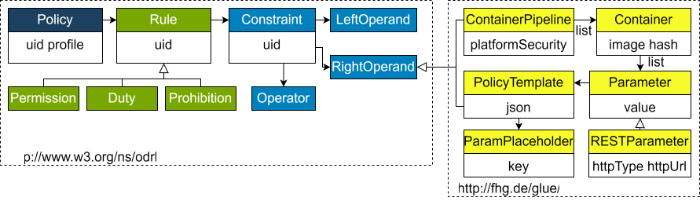
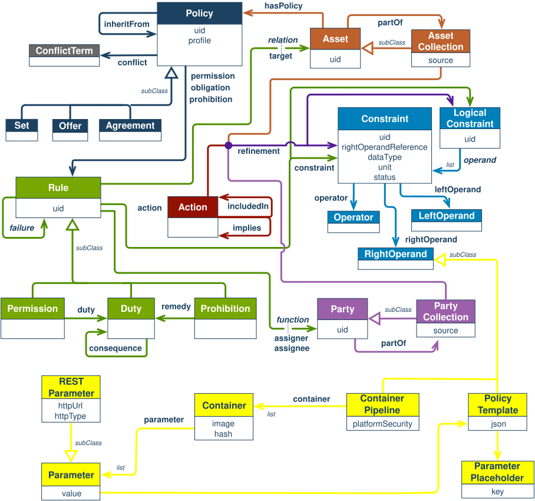
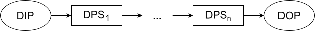
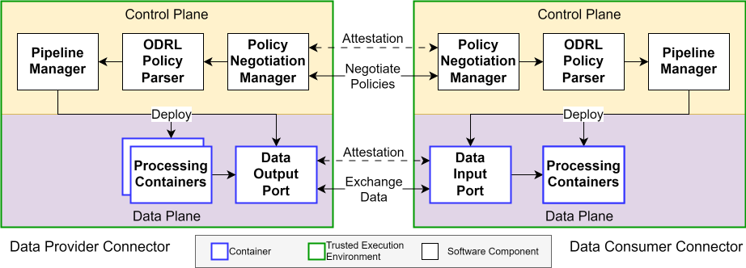
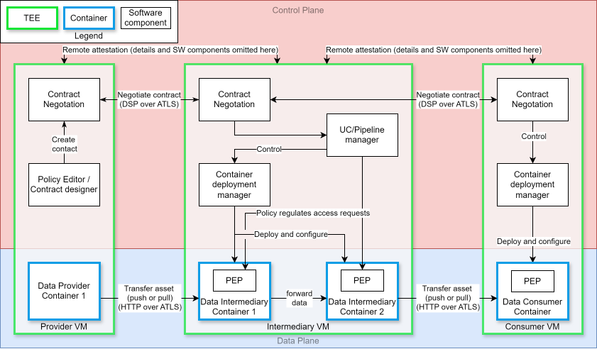

# Concept Details

## Connector Architecture

| Connector deployment with supporting services. Insecure deployments do not include components in grey. |

The figure above shows the services involved in each connector deployment as well as their interactions with each other as well as with the external service containers.
Alongside the trusted connector itself, we deploy a separate docker daemon for each connector. 
The trusted connector uses this docker daemon to manage individual pipeline containers.

The [Container Measurement Component (CMC)](https://github.com/Fraunhofer-AISEC/cmc) provides cross-platform attestation capabilities via its API, which we use to attest the connectors.
Trust anchor is either the Trusted Execution Environment's hardware used for measuring the software stack or a Trusted Platform Module (TPM). 
In our examples we use a software TPM to serve as the attestation backend for the CMC. 
The CMC also manages the TLS certificate we use in the connector.
It fetches these certificates via [Enrollment over Secure Transport (EST)](https://datatracker.ietf.org/doc/html/rfc7030) from the EST server.

## Transitive Usage Control

The core idea behind GLUE is to enforce usage control rules by restricting access to protected data to processors specified in a policy.
The data owner is able to trust that the terms of the policy are followed through attestation before providing any data, even if more than one party is involved.
The figure above shows an exemplary data processing scenario in the GLUE system.

At each operator, the received data enters a local pipeline, which must conform to the restrictions defined in the instantiated policy.
When the derived data is going to be forwarded to connected operators, the GLUE usage control engine instantiates a Policy Template by replacing the placeholders with the parameters provided by the current pipeline containers.
Thereby, GLUE establishes a new usage control policy that governs the processing steps at the subsequent operator's organization.
Only the data that the sub-policy designates as permitted output is released from GLUE control to the end consumers, while any remaining protected data remains under usage control enforcement.
By nesting this approach, GLUE enforces usage control rules across an arbitrary number of processing steps.

## Connection Sequence

The sequence of steps necessary to setup a GLUE pipeline are denoted in the figure above.
The steps include:
1. Remote attestation of the software stack which carries the GLUE connector and all involved parts.
2. The contract for data processing is negotiated.
3. The GLUE connector initializes the specified container pipeline.
4. The data source now sends data to the GLUE connector.

The transitve pipeline is started by one GLUE connector establishing an additional transitive pipeline to another GLUE connector.

5. Remote attestation is performed again as in step 1.
6. A sub-contract is negotiated according to the rules specified in the primary policy.
7. The second GLUE connector initialises the appropriate second data processing pipeline.
8. The derived result data from the first pipeline is sent to the 2nd GLUE connector.

In the end, the data must be released to a data receiver.

9. The data sink is attested in order to guarantee a secure release environment. 
10. Currently, one pipeline can only pass data into another pipeline. 
Therefore, the data sink acts as another pipeline with release logic for the data output, which may be triggered using a pull reqest. 

## Deployment

A transitive GLUE pipeline can typically be deployed among different Trusted Execution Environments as depicted in the figure above. 
Not all GLUE connector have to be on the same system. 
Each endpoint and starting points need to remotely attest each other to enable a fully trusted, usage controlled combination of data processing pipelines.

## Policies

The GLUE connector uses the widely used, standardized [ODRL](https://www.w3.org/TR/odrl-model/) format.
While ODRL provides a comprehensive model for expressing usage rights through rules, constraints, and obligations, it lacks concepts for GLUE’s data processing pipelines and transitively negotiated contracts. 
Therefore, the standard format is extended with additional dedicated attributes and concepts specifically designed for the GLUE connector as shown in the figures below.
For instance, **Data Processing Pipelines** were added for representing data processing workflows in usage control policies.
The figure above shows the simplified overview. 
The figure below shows the "ODRL Core Profile Information Model" extended with classes from the GLUE custom profile, which is a detailed complete overview of the extension.

### Pipeline Layout

As shown above, a GLUE data pipeline consists of three elements:

* a defined data input port (DIP),
* one or more data processing steps (DPS), and
* a defined data output port (DOP).

Input and output ports specify permitted port mappings and protocols for data transfer and result retrieval. 
Each processing step is uniquely identified by a cryptographic hash covering its software artifact, including binaries, configuration, and initial data.

Unlike approaches that model only abstract algorithms, GLUE represents concrete processing steps as software artifacts.
Multiple steps can be chained to compose complex pipelines combining processing operations and protocol adapters.

Data processing pipelines are modeled as a subtype of the ODRL `RightOperand` class, allowing them to be used in ODRL constraints and action refinements. 
Constraints can restrict which pipelines may process an asset, while action refinements can require a specific pipeline to be executed. 
For this purpose, the GLUE profile introduces the `deployPipeline` action, which the framework executes on behalf of the data owner.

## Full Component Overview
<!--- TODO Old figure, still needed? Redundant to other figure below. 

--> 

The figure above shows a detailed architecture overview of a two-level transitive data processing pipeline.
The data flow originates at the Provider VM on the left, passas through the Intermediary VM, and ultimately ends in the Consumer VM on the right hand side.
Each of the VMs makes use of confidential computing, as they all need to be executed inside a trusted execution environment, here denoted in green.
The software artifacts, which are necessary for managing the pipeline and contract negotiation are marked in white boxes with a black border. 
Dynamically spawned containers, each depending on the given policy, are shown in blue boxes.

For a simplified view the components for remote attestation are neglected, however, during connection setup each VM has to attest the next peer before a data transmission can begin, as denoted using arrows at the top.
The contract negotiation component has to be available in each GLUE connector and addresses the negotiation from one peer to the next.
The UC/Pipeline manager issues policies and controls the container deployment manager. 
The container deployment manager deploys and configures the containers of each pipeline.
The Policy Enforcement Point (PEP) has to be available within each container, however, in GLUE the PEP is indirectly implemented by the available logic of containers and enforced by feature availablity.

## More Information

Next can be seen the [Use Cases](use-cases.md).