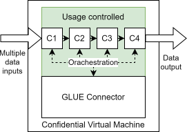
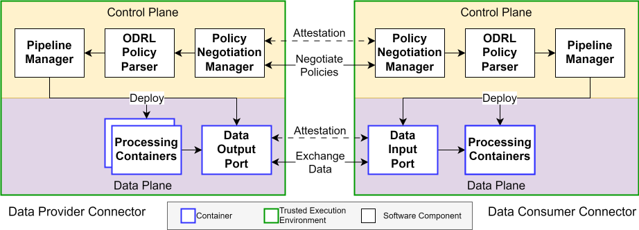

# General Concept Overview

This section provides an abstract overview of the involved parties and the main architecture of the GLUE framework.

## Concept Overview

GLUE makes use of a Confidential VM (CVM), which is a TEE-protected VM. 
The CVM contains a Docker engine inside. 
The GLUE connector orchestrates the instantiation of a data processing pipeline consisting of chained docker containers with highly restricted permissions in a processing chain. 
Data may only enter into the first container, here C1, and may only leave the usage controlled environment at the last container, here C4.
Either C4 implements a data output as reply to a previous user request or the data is forwarded into another pipeline.
The usage controlled area is denoted in green and under full control of the parties which agreed upon the corresponding data processing policy.

## Layered Overview

This section details an overview separated into control and data plane as shown in the following figure.

First, two connectors negotiate a policy on the control plane.
The policy defines permitted containers and data flows that must be adhered to during the data process. 
Then the connector spawns a local pipeline which implements the exact data flow from the policy.
The respective Docker engine must use hash measurements to prove that the correct containers are running unchanged. 
The respective configurations of the containers is also generated from parameters in the policy.
The whitelisting of docker containers and their data processing order narrows down the acceptable data flow and is enforced by the framework.

The control plane deals with the negotiation of accepted policies. 
The format applied is ODRL, more information about the topic can be found in [Concept Deep-Dive](concept-details.md).
The data plane focusses only on the transmission of datasets.
This is the plane, where the GLUE connector launches, attests and enforces the previously agreed upon data processing pipelines.
The data flow must be implemented directly in the form of a chain (or a directed graph which is currently future work) from one container to the next.

More information can be found in the [Concept Deep-Dive](concept-details.md).