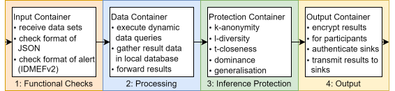
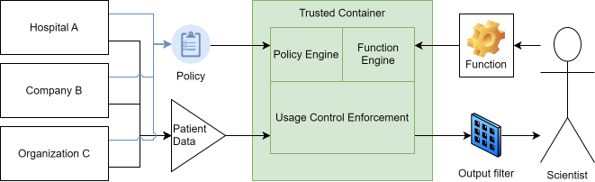
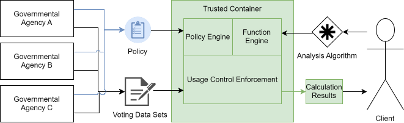
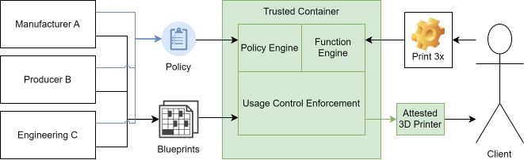

# List of Use Cases für Usage Control
The following are examples of Usage Control that can be realized using our Trusted Connector Next.

## Usase Control for Generation of Cyber-Threat-Intelligence (CTI)

**Scenario:**
Multiple Security Operation Centers (SOCs) all collect data individually in their domain.

**Problem:** 
Analyzing alert data is required to generate advanced Cyber Threat Intelligence (CTI) for more parties or even the public domain.
However, alert data is extremely sensitive as it may harm the organization which is put under surveillance, if the data is leaked.
Also, due to legal restrictions, SOCs typically are not allowed to share any alert data.

**Solution:** 
A usage controlled CTI process which may collect data from multiple SOCs with predifined processing procedures can enable collaborative CTI. 
The predefined processing procedures include functional checks, the processing of the data, inference protection, and the regulated release of output results according a procedure which all participants have previously agreed upon via policy agreement.

## Usage Control for Medical Data
**Scenario:**
Patients share their data with government agencies or hospitals to receive analytical services.
Government agencies or medical organizations store this sensitive data in the cloud and are only allowed to pass it on under very strict conditions.

**Problem:** 
Medical data is often extremely sensitive data. 
Access to this data is often only possible under very strict regulations and passing it on is usually completely prohibited.
Nevertheless, there is often a need to combine datasets of patients from different disease measurements from different hospitals, organizations or companies in order to gain special insights from the data.

**Solution:** 
With confidential computing coupled with usage control enforcement, an architecture can be designed in which everyone involved can trust that access to the data is regulated according to imposed restrictions.
On the one hand, the data providers can be sure that the raw data cannot be extracted. 
On the other hand, studies, aggregations, or combinations of data can be compiled from multiple sources that would otherwise not be legally or technically feasible. 
The main condition is that the results of the operations or analyzes do not provide any indications of the raw data and are filtered accordingly.

## Usage Control for Governmental Data
> [!NOTE]
> Wahrscheinlich hauptsächlich meine persönliche Meinung, aber mit Wahlen als Anwendungsfall macht man schon ein Fass auf.
> Es darf nirgendwo stehen, wer was gewählt hat, was man aber für Analysen braucht.
>
> Rep: Naja gerade das zu lösen ist ja gerade unten beschrieben. 

**Scenario:** 
Citizens pass on their election data, i.e. votes, to government ballot boxes. 
The government must archive all election records and ensure that this sensitive data is only permitted for certain analyses.

**Problem:** 
Analyses that draw conclusions about voter behavior, such as changing votes or demographic and regional analyses, require insight into the raw data.
However, this is typically not allowed or desired by the governmental agency which must protect the privacy of the voters.

**Solution:**
With confidential computing, coupled with usage control enforcement, an architecture can be designed in which everyone involved can trust that access to the data is only permitted in ways that ensure anonymity of voters and their privacy.
Sensitive election data can be collected and combined from different government agencies and different states without having to reveal the raw data.
More complex algorithms for a more comprehensive and precise analysis of voter behavior can be secured using usage control than would be the case with conventional projections.

## Usage Control in Industrial Manufacturing

**Scenario:** 

Companies with blueprints for manufacturing and production factories belong to different parties. 
Either the companies want to perform contract manufacturing, where the factory is owned by a third party, or the third party needs components for their machines and equipment, but on-site production is faster than delayed delivery.
In any case, product owners of these products do not want to give up their intellectual property, i.e. the blueprints for manufacturing them.

**Problem:**
Sharing the blueprint would effectively nullify competitive advantages gained through their development.  
Nevertheless, the components should be able to be manufactured on site.

**Solution:** 
An architecture incorporating usage control and remote attestation of production machines' firmware enables blueprints to be sent safely and securely to an on-site confidential VM and stored there in RAM inaccessible to the outside world.
Only the remotely attested machine is able to receive instructions for production from this VM, which is also remotely attested and secured by the data provider.
A reconstruction of the previously sent blueprint can only be done using lower quality methods, such as 3D scanning of the finished printed object with smoothing calculations and rounding errors.
In this way, a company would be able to produce products on site and rent the blueprints in a technically secure manner for a predetermined number of printing processes.

## More Information

Next can be seen the [Containers and their Functions](containers.md).