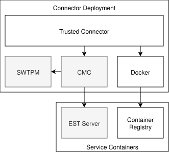

# GLUE Connector Example

This directory contains examples for the deployment of the GLUE connector.
The examples consist of multiple instances of the connector and their supporting infrastructure deployed using docker compose.

Currently, only the multi-stage example is available, which consists of three connectors that exchange control- and
data-plane messages over attested TLS.

## Dependencies

Running the example requires docker compose, openssl, jq, jo, envsubst, curl, and skopeo.

### Debian-based systems

> [!NOTE]
> The installation command assumes that the [official docker repository](https://docs.docker.com/engine/install/debian/#install-using-the-repository) is configured.

```shell
apt install docker-ce docker-ce-cli containerd.io docker-buildx-plugin docker-compose-plugin openssl jq jo gettext-base curl skopeo
```

### Arch Linux

```shell
pacman -S docker docker-buildx docker-compose openssl jq jo gettext curl skopeo
```

### Nix Shell

```shell
nix-shell -p docker-client docker-buildx docker-compose openssl jq jo gettext curl skopeo
```

## Usage

The main entrypoint for the example is the `example.sh` script.
It spins up all required connectors and supporting infrastructure with docker compose, initiates contract negotiation
and establishes data pipelines.

The script expects the name of the example to run as its first argument.
Additional arguments can be passed to alter the behaviour of the script as follows:

```
Usage: ./example.sh [Options] <example name>
Options:
  --insecure        Disable aTLS
  --regenerate-pki  Generate new certificates
  --refetch-images  Re-fetch all container images from the registry
  --initial         The name of the initial container (default: initiator)
  --intermediary    The name of the first contract recipient container (default: intermediary)
  --initial         The name of the final container (default: destination)
  --help            Show this message and exit
```

## Example Structure

### Connector Deployment

All examples consist of one or more connector deployments and a set of supporting infrastructure.
We deploy each service in a separate docker container and link them together where necessary.
In a production deployment, each deployment would consist of a single confidential VM with the required services running
directly on the system.
We use the docker compose `depends_on` and `healthcheck` features to make sure that services start in the correct order.
Related services communicate via a linked network namespace as well as a dedicated shared volume where we place shared
sockets and files.

|                                                                        |
|:----------------------------------------------------------------------------------------------------------------:|
| Figure 1: Connector deployment with supporting services. Insecure deployments do not include components in grey. |

Figure 1 shows the services involved in each connector deployment as well as their interactions with each other as well
as with the external service containers.
Alongside the trusted connector itself, we deploy a separate docker daemon for each connector. The trusted connector
uses this docker daemon to manage individual pipeline containers.
To ensure that the examples work in any environment, we bundle all container images and load them into a local container
registry on startup.

The [Container Measurement Component (CMC)](https://github.com/Fraunhofer-AISEC/cmc) provides cross-platform attestation
capabilities via its API, which we use to attest the connectors.
We use a software TPM to serve as the attestation backend for the CMC. The CMC also manages the TLS certificate we use
in the connector.
It fetches these certificates via [Enrollment over Secure Transport (EST)](https://datatracker.ietf.org/doc/html/rfc7030)
from the EST server.
When using the `--insecure` flag, these containers are not used or created.

### Example Workflow

TODO: Explain what the scripts do
